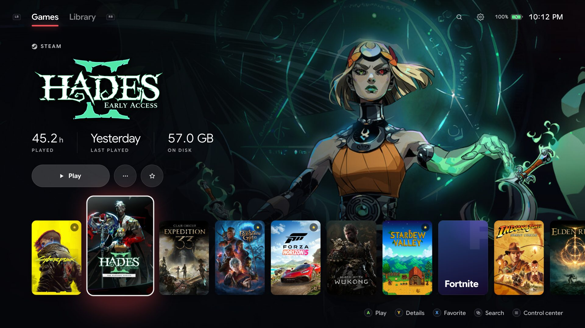
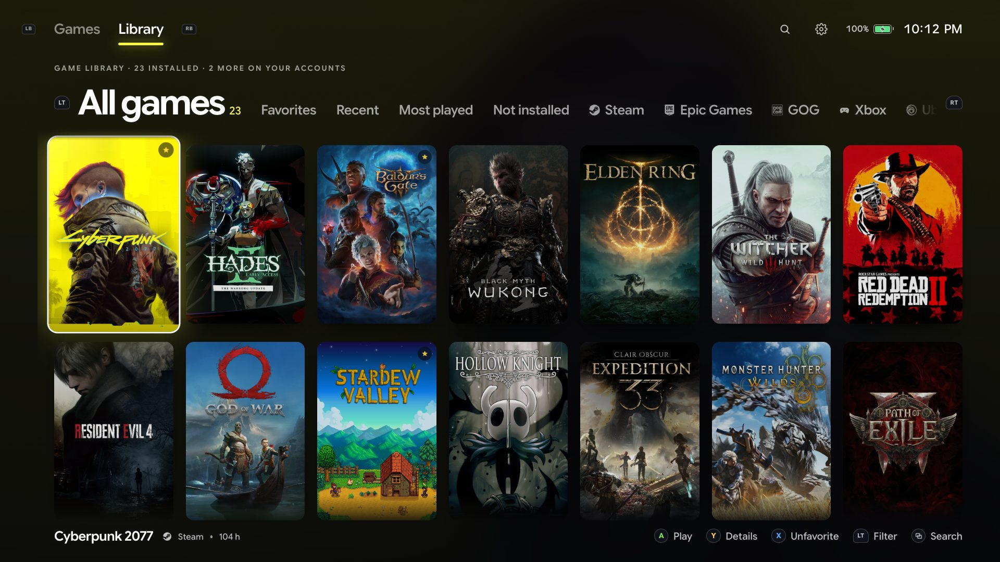
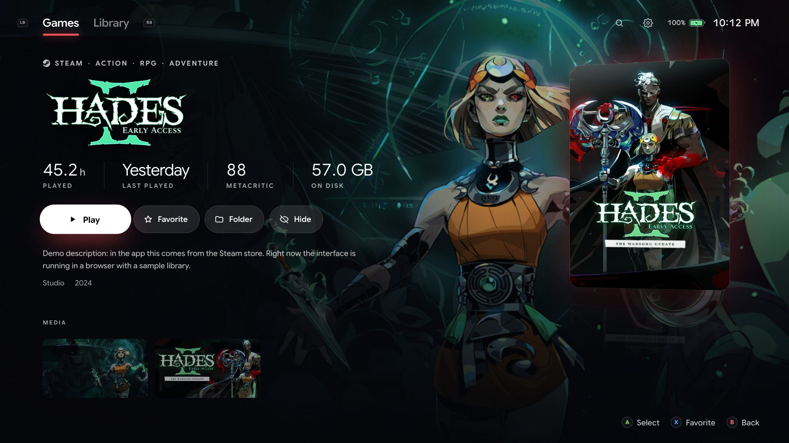

# Mantel

A console-style home screen for Windows handhelds. Mantel puts every game you have
installed (Steam, Epic, GOG, Xbox / Game Pass, Ubisoft Connect and anything else) on one
fullscreen shelf you drive with the controller. Games still launch through their own
stores, so nothing gets reinstalled or reconfigured.

Built on and for the ROG Xbox Ally X; it should feel at home on any Windows handheld or a
TV PC.



| Library | Game details |
| --- | --- |
|  |  |

## Features

- **Works on first launch.** Mantel finds installed games on its own: no plugins, no
  per-store setup.
- **Controller first.** Every screen works with the gamepad, the touchscreen or a keyboard.
  The control center (≡) closes games, restarts or powers off the device.
- **Playtime that adds up.** Mantel times every session itself and, with your accounts
  connected, brings in playtime from Steam and Xbox across all your devices.
- **Your whole collection.** Sign in to Steam or Xbox to also see the games you own but
  haven't installed. Picking one opens its install page in Steam or the Xbox app.
- **Steps aside while you play.** Mantel minimizes when a game starts and comes back when
  it exits.
- **Art for everything.** Covers, backgrounds and logos come from Steam and GOG; a free
  SteamGridDB key covers the rest.

## Install

Download `Mantel_x.y.z_x64-setup.exe` from
[Releases](https://github.com/jarto666/mantel/releases) and run it. Turn on Settings →
*Start with Windows* to boot the handheld straight into Mantel. New versions show up in
Settings, one button to install.

The installer isn't code-signed yet, so Windows may show "Windows protected your PC":
choose *More info → Run anyway*.

## Where games come from

| Store | Installed games | With your account |
| --- | --- | --- |
| Steam | Library folders and app manifests, playtime from Steam's own files | Every owned game, playtime from all devices |
| Xbox / Game Pass / Microsoft Store | Packages that ship a `MicrosoftGame.config` | Play history and minutes played |
| Epic Games | Launcher manifests and catalog cache | Coming later |
| GOG | Registry; launches through Galaxy when installed | Coming later |
| Ubisoft Connect | Registry | Coming later |
| Anything else | Settings → *Add a game manually*: suggested shortcuts, or any `.exe`, `.lnk` or `.url` | |

## Accounts and privacy

Mantel has no servers and sends no telemetry. It talks only to the services you use:

- **Steam.** You sign in on Steam's own page inside Mantel; Mantel never sees your
  password, and email Steam Guard codes work. Mantel then reads your owned games with the
  same short-lived token the Steam store page uses.
- **Xbox.** You sign in on Microsoft's own page and allow Mantel to read your Xbox profile.
  Mantel reads your play history and minutes played from Xbox Live.
- **Artwork.** Steam's store and image servers, GOG's public API and, if you add a key,
  SteamGridDB.

Everything stays on your PC in `%APPDATA%\com.playmantel.launcher\`: `user.json` holds
settings, favorites, playtime and the account tokens; `cache.json` can be deleted at any
time. Settings → Accounts signs you out and deletes the tokens.

## Controls

| Button | Action |
| --- | --- |
| A | Play |
| B | Back |
| Y | Game details |
| X | Favorite |
| LB / RB | Games ↔ Library ↔ Settings |
| LT / RT | Library filters |
| View (⧉) | Search |
| Menu (≡) | Control center: close game, restart, power off, desktop |

On a keyboard: arrows, Enter, Esc, `i` details, `f` favorite, `q` / `e` tabs, `/` search,
`m` menu.

## Develop

Mantel is [Tauri 2](https://tauri.app) (Rust) with a React + TypeScript UI.

```bash
npm install
npm run dev          # the UI in a browser with a sample library, at http://localhost:1420
```

A gamepad connected to your computer works in the browser too. On Windows,
`npm run tauri dev` runs the real app and `npm run tauri build` makes the installer.

### From a Mac

The Windows exe cross-compiles with [cargo-xwin](https://github.com/rust-cross/cargo-xwin)
(`brew install llvm lld`, `rustup target add x86_64-pc-windows-msvc`,
`cargo install cargo-xwin`):

```bash
PATH="/opt/homebrew/opt/llvm/bin:/opt/homebrew/opt/lld/bin:$PATH" npm run build:win
```

This builds the portable `src-tauri/target/x86_64-pc-windows-msvc/release/mantel.exe`;
installers come from CI.

`tools/ally.sh` is the loop used to build Mantel against a real handheld over SSH: a dev
build that loads the UI from the Mac with live reload, deploys to the device, restarts the
app on its screen and opens WebView DevTools. `tools/ally-ssh-setup.ps1` sets up SSH on the
handheld; see the comments in both files.

### Releasing

1. Bump `version` in `package.json` (the app reads its version from there).
2. Push a tag: `git tag v0.2.0 && git push origin v0.2.0`.
3. CI builds the installer and the update manifest into a draft release. Publishing the
   draft is what makes installed copies offer the update.

Updates are signed: the release job needs the `TAURI_SIGNING_PRIVATE_KEY` and
`TAURI_SIGNING_PRIVATE_KEY_PASSWORD` repository secrets, matching `plugins.updater.pubkey`
in `src-tauri/tauri.conf.json`.

### Forks

Please use your own Xbox app registration (a personal-accounts Azure app with the redirect
URI `https://login.live.com/oauth20_desktop.srf`; put its client ID in
`src-tauri/src/accounts.rs`) and your own updater key and release URL in
`src-tauri/tauri.conf.json`.

## Contributing

Issues and pull requests are welcome; see [CONTRIBUTING.md](CONTRIBUTING.md).

## License

[GPL-3.0-or-later](LICENSE). Mantel is not affiliated with Valve, Microsoft, ASUS, Epic
Games, GOG or Ubisoft. Game names and artwork belong to their owners.
