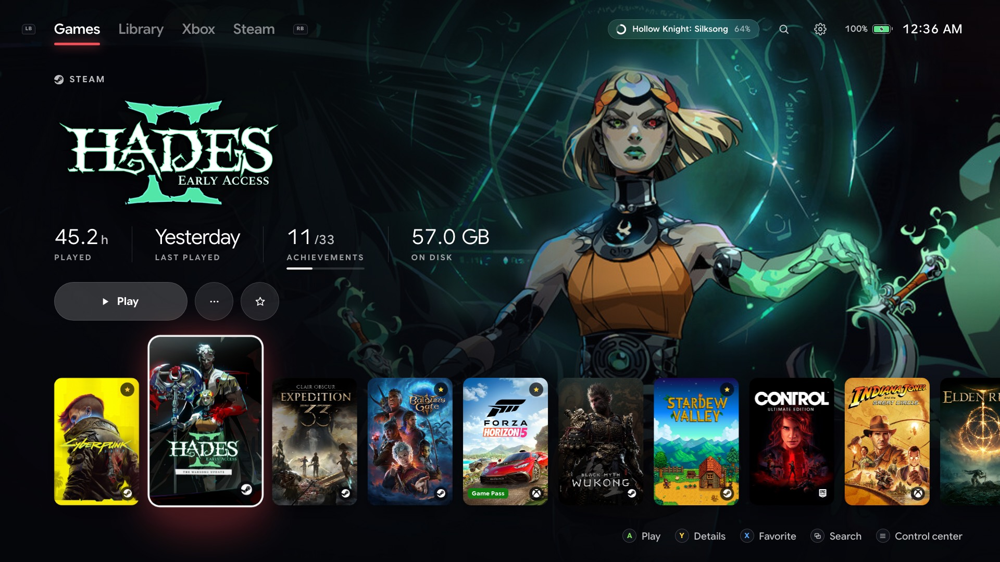
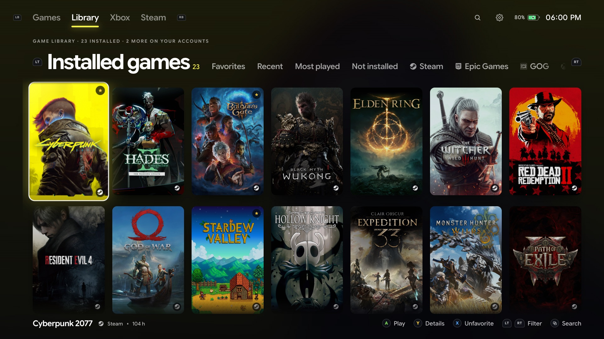
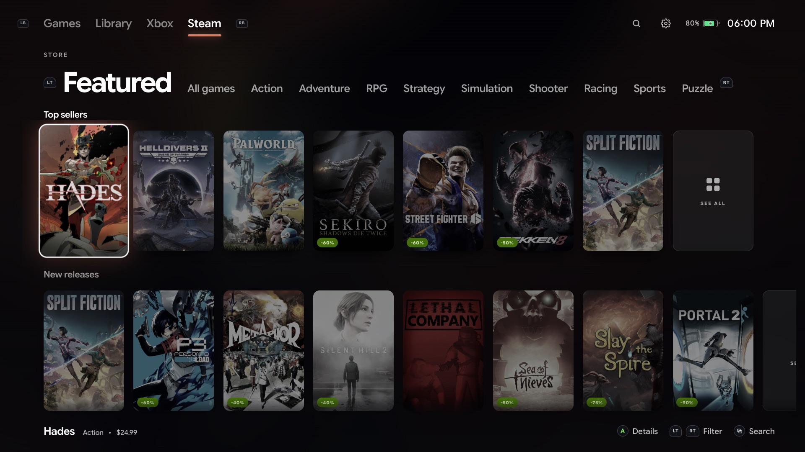
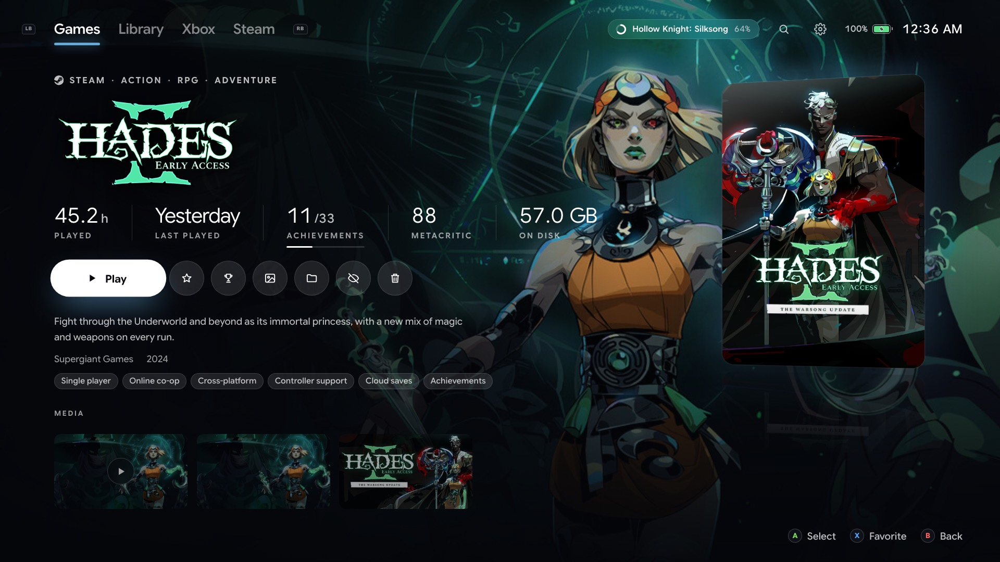

# Mantel

A console-style home screen for Windows handhelds. Mantel puts every game you have
installed (Steam, Epic, GOG, Xbox / Game Pass, Ubisoft Connect and anything else) on one
fullscreen shelf you drive with the controller. Games still launch through their own
stores, so nothing gets reinstalled or reconfigured.

Built on and for the ROG Xbox Ally X; it should feel at home on any Windows handheld or a
TV PC.



| Library | Stores | Game details |
| --- | --- | --- |
|  |  |  |

## Features

- **Works on first launch.** Mantel finds installed games on its own: no plugins, no
  per-store setup.
- **Controller first.** Every screen works with the gamepad, the touchscreen or a keyboard.
  The control center (≡) sets volume and brightness, shows Wi-Fi and battery, closes
  games, restarts or powers off the device. Several games and programs can run at once;
  each one closes from its own card.
- **Playtime that adds up.** Mantel times every session itself and, with your accounts
  connected, brings in playtime from Steam and Xbox across all your devices.
- **One library, two stores.** The Library holds everything you have from every store,
  installed or not, with a filter for each store. Sign in to see all your Steam games and the
  Xbox games you've played. The Xbox tab is the PC Game Pass catalog and the Microsoft Store,
  the Steam tab the Steam store, each with lists by genre and shelves that open into full
  grids. Search reaches both stores too. Buying happens in the store itself.
- **Install from the couch.** Game Pass games and anything else on your Microsoft account
  install right in Mantel through Windows' own installer, with a list of editions showing
  what's yours and what the others cost. Steam games go through Steam's dialog. Progress, speed and time left show on the
  home screen, downloads carry on with Mantel closed, and uninstalling works the same way.
- **In your language.** English, French, German, Spanish and Russian.
- **Achievements.** With an account connected, every Steam and Xbox game shows its
  progress, and its page lists each achievement with rarity and gamerscore.
- **Trailers.** Rest on a game for a moment and its trailer plays, muted, behind it.
  Settings → Interface turns that off.
- **Apps next to the games.** The Apps tab opens music, video, chat and browsers: Microsoft
  Store and Edge are there from the start, and Spotify, Netflix, Discord and other apps you
  have join by themselves. Anything else adds from the Start menu, a list of sites such as
  YouTube and Twitch that open in their own window, or a file. Apps open, switch and close
  like games, but an open app is only a dot on its tile: no timer, no "Playing", and it
  doesn't hold back updates. Time in apps isn't counted as playtime.
- **Steps aside while you play.** Mantel minimizes when a game starts and comes back when
  it exits.
- **Art for everything.** Covers, backgrounds and logos come from Steam and GOG; a free
  SteamGridDB key covers the rest.

## Install

Download `Mantel_x.y.z_x64-setup.exe` from
[Releases](https://github.com/jarto666/mantel/releases) and run it. On first start, a short
setup asks for your language, signs you in to Steam and Xbox if you like, and makes Mantel
start with the handheld: as the home app of Xbox mode, or with Windows. Settings → System →
*Run setup again* brings it back. When a new version is out, Mantel offers it as it starts:
one button installs it, with the download on screen, and Mantel restarts by itself.

The installer isn't code-signed yet, so Windows may show "Windows protected your PC":
choose *More info → Run anyway*. Signing will come through SignPath Foundation; see the
[code signing policy](https://playmantel.com/code-signing).

### As the home app of Xbox mode

Windows' full screen experience (Xbox mode) boots into a *home app* instead of the desktop.
Mantel's setup, or Settings → System → *Home app*, makes Mantel that app with one button.
Windows takes a home app from outside the Store only in Developer Mode, so Mantel turns it
on first, and Windows asks you to allow that once. The handheld then starts in Mantel, the
Home button in Game Bar returns to it, and Mantel's menu (≡) switches between Xbox mode and
the desktop. Uninstalling Mantel gives Xbox mode back the home app it had before.

## Where games come from

| Store | Installed games | With your account |
| --- | --- | --- |
| Steam | Library folders and app manifests, playtime from Steam's own files | Every owned game, playtime from all devices, achievements |
| Xbox / Game Pass / Microsoft Store | Packages that ship a `MicrosoftGame.config` | Play history, minutes played, achievements |
| Epic Games | Launcher manifests and catalog cache | Coming later |
| GOG | Registry; launches through Galaxy when installed | Coming later |
| Ubisoft Connect | Registry | Coming later |
| Anything else | Settings → *Add a game manually*: suggested shortcuts, or any `.exe`, `.lnk` or `.url` | |

## Accounts and privacy

Mantel has no servers and sends no telemetry. It talks only to the services you use:

- **Steam.** You sign in on Steam's own page inside Mantel; Mantel never sees your
  password, and email Steam Guard codes work. Mantel then reads your owned games and achievements
  with the same short-lived token the Steam store page uses.
- **Xbox.** You sign in on Microsoft's own page and allow Mantel to read your Xbox profile.
  Mantel reads your play history, minutes played and achievements from Xbox Live.
- **Store catalogs.** Microsoft's public Game Pass and Store catalogs and Steam's store, for
  the lists to browse and for search, which sends them what you type. No account is involved
  in reading them.
- **Installing.** Store installs go through Windows' own installer, under the Microsoft
  account signed in to Windows; Steam installs go through the Steam client.
- **Artwork and trailers.** Steam's store, image and video servers, GOG's public API and,
  if you add a key, SteamGridDB.

Everything stays on your PC in `%APPDATA%\com.playmantel.launcher\`: `user.json` holds
settings, favorites, playtime and the account tokens, which are encrypted for your Windows
user (DPAPI); `cache.json` can be deleted at any time. Settings → Accounts signs you out and deletes the tokens.

## Controls

| Button | Action |
| --- | --- |
| A | Play |
| B | Back |
| Y | Game details |
| X | Favorite |
| LB / RB | Games ↔ Library ↔ Xbox ↔ Steam ↔ Settings |
| LT / RT | Filters |
| View (⧉) | Search |
| Menu (≡) | Control center: volume, brightness, close game, restart, power off, desktop |

On a keyboard: arrows, Enter, Esc, `i` details, `f` favorite, `q` / `e` tabs, `/` search,
`m` menu.

## Develop

Mantel is [Tauri 2](https://tauri.app) (Rust) with a React + TypeScript UI.

```bash
npm install
npm run dev          # the UI in a browser with a sample library, at http://localhost:1420
```

A gamepad connected to your computer works in the browser too. On Windows,
`npm run tauri dev` runs the real app and `npm run tauri build` makes the installer.

### From a Mac

The Windows exe cross-compiles with [cargo-xwin](https://github.com/rust-cross/cargo-xwin)
(`brew install llvm lld`, `rustup target add x86_64-pc-windows-msvc`,
`cargo install cargo-xwin`):

```bash
PATH="/opt/homebrew/opt/llvm/bin:/opt/homebrew/opt/lld/bin:$PATH" npm run build:win
```

This builds the portable `src-tauri/target/x86_64-pc-windows-msvc/release/mantel.exe`;
installers come from CI.

`tools/ally.sh` is the loop used to build Mantel against a real handheld over SSH: a dev
build that loads the UI from the Mac with live reload, deploys to the device, restarts the
app on its screen and opens WebView DevTools. `tools/ally-ssh-setup.ps1` sets up SSH on the
handheld; see the comments in both files.

### Releasing

1. Bump `version` in `package.json` (the app reads its version from there).
2. Push a tag: `git tag v0.2.0 && git push origin v0.2.0`.
3. CI builds the installer and the update manifest into a draft release. Publishing the
   draft is what makes installed copies offer the update.

Updates are signed: the release job needs the `TAURI_SIGNING_PRIVATE_KEY` and
`TAURI_SIGNING_PRIVATE_KEY_PASSWORD` repository secrets, matching `plugins.updater.pubkey`
in `src-tauri/tauri.conf.json`.

### Forks

Please use your own Xbox app registration (a personal-accounts Azure app with the redirect
URI `https://login.live.com/oauth20_desktop.srf`; put its client ID in
`src-tauri/src/accounts.rs`) and your own updater key and release URL in
`src-tauri/tauri.conf.json`.

## Contributing

Issues and pull requests are welcome; see [CONTRIBUTING.md](CONTRIBUTING.md).

## Code signing policy

Free code signing provided by [SignPath.io](https://about.signpath.io), certificate by
[SignPath Foundation](https://signpath.org). Only installers that GitHub Actions builds from
this repository are signed, and each signing request is approved by hand. Team roles, what the
installer changes and the privacy notes are on [playmantel.com/code-signing](https://playmantel.com/code-signing).

## License

[GPL-3.0-or-later](LICENSE). Mantel is not affiliated with Valve, Microsoft, ASUS, Epic
Games, GOG or Ubisoft. Game names and artwork belong to their owners.
